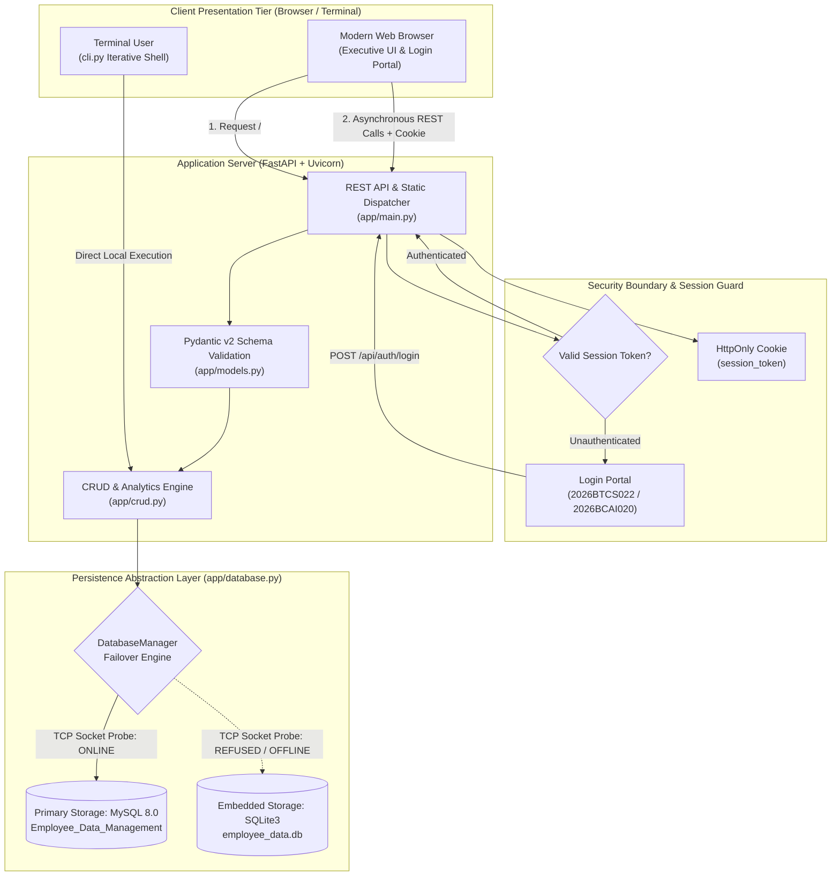
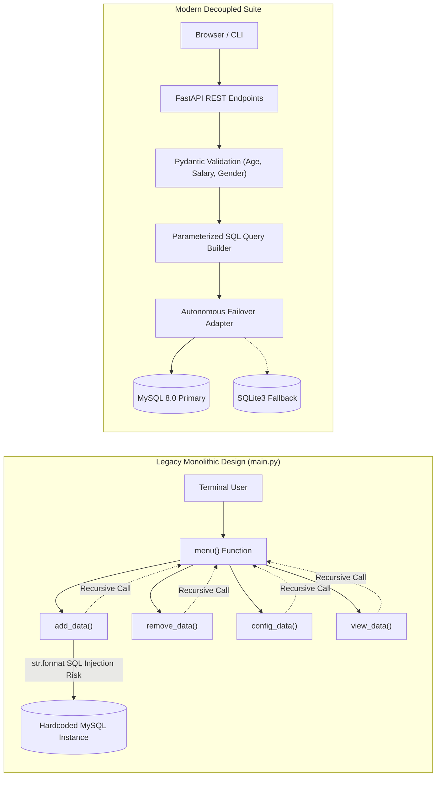
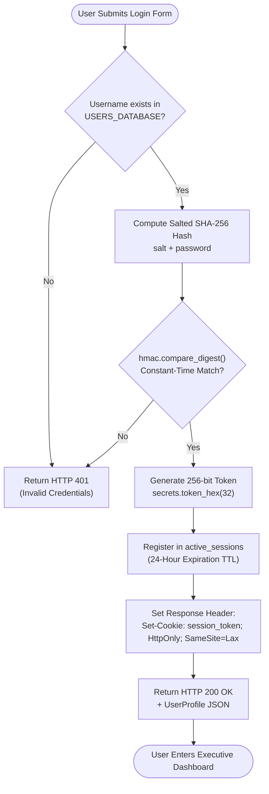
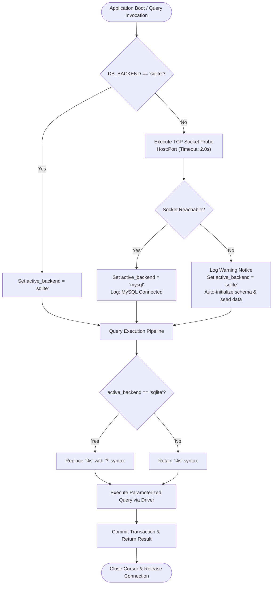
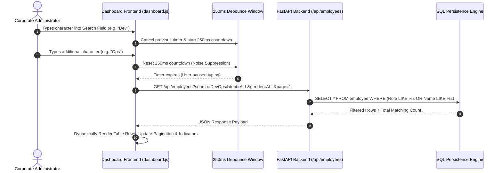

# Employee Data Management — Enterprise Suite & Dashboard

[](https://www.python.org/)
[](https://fastapi.tiangolo.com/)
[](https://www.mysql.com/)
[](LICENSE)

A complete, business-focused Employee & Payroll Management platform featuring a high-productivity **Web Dashboard**, modern **FastAPI** REST backend, resilient **MySQL/SQLite** autonomous database engine, and a hardened terminal **CLI**.

---

## 📑 Table of Contents
- [🌟 Features Overview](#-features-overview)
- [🔄 Architecture & System Flowcharts](#-architecture--system-flowcharts)
  - [1. End-to-End System Architecture](#1-end-to-end-system-architecture)
  - [2. Legacy vs. Modernized Architecture](#2-legacy-vs-modernized-architecture)
  - [3. Authentication & Session Decision Tree](#3-authentication--session-decision-tree)
  - [4. Autonomous Database Failover Pipeline](#4-autonomous-database-failover-pipeline)
  - [5. Client-Side Debounced Search & Event Pipeline](#5-client-side-debounced-search--event-pipeline)
- [📂 Codebase Directory Structure](#-codebase-directory-structure)
- [💻 Module & Code-to-Function Mapping](#-module--code-to-function-mapping)
- [🚀 Quick Start & Installation](#-quick-start--installation)
- [🗄️ Database Setup & Schema](#️-database-setup--schema)
- [🌐 REST API Reference](#-rest-api-reference)
- [🛡️ Security Hardening & Vulnerability Fixes](#️-security-hardening--vulnerability-fixes)
- [📄 Academic Project Documentation](#-academic-project-documentation)

---

## 🌟 Features Overview

- **Secure Authentication & Login Portal**:
  - Pre-configured institutional credentials (`2026BTCS022` and `2026BCAI020`).
  - Salted SHA-256 password hashing with constant-time comparison (`hmac.compare_digest`).
  - Cryptographically secure 256-bit session tokens stored via `HttpOnly`, `SameSite=Lax` cookies.
  - Interactive credential chips and show/hide password toggle.
- **User Profile & Security Clearance**:
  - Live authenticated profile pill in the executive top header.
  - Detailed Profile Modal displaying assigned department, institutional email, clearance role, and granted system permissions.
- **One-Click Sign Out**: Instant server-side session termination and cookie invalidation.
- **Executive KPI Dashboard**: Live tracking of workforce headcount, cumulative annual payroll, mean salary, and departmental breakdown.
- **Full CRUD Management**:
  - **Create**: Add employees with field validation (`Emp_no`, `Name`, `Gender`, `Age`, `Role`, `Dept`, `Salary`).
  - **Read**: Dynamic roster table with real-time debounced text search, department & gender filtering, multi-column sorting, and pagination.
  - **Single Lookup**: Search single employee profiles by ID (Option 4 'R' parity).
  - **Update**: Modal configuration of employee fields (Age, Role, Department, Salary, Name).
  - **Delete**: Safe deletion with confirmation modal (Option 2 parity).
- **Business Intelligence**: Department distribution progress bars and demographic representation analysis.
- **Enterprise Reporting**: One-click streaming CSV export (`/api/export/csv`) of the entire employee dataset.
- **Database Resilience**: Built for **MySQL** with automatic fallback to **SQLite** if MySQL is not yet configured or offline.
- **Security Hardened**: 100% parameterized SQL queries (immune to SQL injection), no recursion call stack overflow, and deterministic cursor lifecycle management.
- **Dual Interface**: Run the high-productivity Web Dashboard or launch the terminal CLI.

---

## 🔄 Architecture & System Flowcharts

### 1. End-to-End System Architecture

The following diagram illustrates the interaction between the Presentation Tier, Security Boundary, Application Server, and the Persistence Layer:



---

### 2. Legacy vs. Modernized Architecture

A comparison between the legacy monolithic script and the re-engineered three-tier decoupled platform:



---

### 3. Authentication & Session Decision Tree

How user verification, cryptographic tokens, and clearance levels are evaluated:



---

### 4. Autonomous Database Failover Pipeline

How the system achieves zero-downtime availability even if MySQL is temporarily stopped:



---

### 5. Client-Side Debounced Search & Event Pipeline

Treating keystrokes and user actions as incoming signals, filtering noise via a 250ms debounce window to prevent database flooding:



---

## 📂 Codebase Directory Structure

```
employee-data-management-sql-based/
├── app/
│   ├── config.py           # Configuration and environment variable loader
│   ├── auth.py             # Authentication, password hashing, and session management
│   ├── database.py         # Unified MySQL / SQLite database engine manager
│   ├── models.py           # Pydantic data schemas & validation
│   ├── crud.py             # Parameterized SQL business logic
│   ├── main.py             # FastAPI REST API routes & static file server
│   ├── static/             # Frontend assets
│   │   ├── css/dashboard.css
│   │   └── js/dashboard.js
│   └── templates/
│       └── index.html      # Responsive executive web interface
├── docs/                   # Academic specifications and presentation reports
│   ├── Employee_Data_Management_Project_Report.pdf   # Formatted University PDF Report
│   ├── Employee_Data_Management_Project_Report.docx  # Editable Word Project Report
│   └── PROJECT_DOCUMENTATION.md                      # Comprehensive Technical Markdown
├── legacy/                 # Preserved original school project code
│   ├── original_main.py    # Untouched original CLI script
│   └── original_README.md  # Original database notes
├── scripts/
│   ├── schema.sql          # MySQL database schema DDL
│   ├── sample_data.sql     # Enterprise seed data (20 employees)
│   ├── seed.py             # Python database seeding tool
│   ├── generate_docx_report.py  # Script generating the Word report
│   └── generate_pdf_report.py   # Script generating the PDF report
├── cli.py                  # Fixed, secure terminal CLI
├── main.py                 # Unified launcher (starts Web or CLI)
├── requirements.txt        # Python package dependencies
└── .env.example            # Environment configuration template
```

> 💡 **Original Pristine Branches**: The original school project files are also preserved on their own untouched Git branches:
> - **[`legacy` branch](https://github.com/dioatro/employee-data-management-sql-based/tree/legacy)**
> - **[`original` branch](https://github.com/dioatro/employee-data-management-sql-based/tree/original)**

---

## 💻 Module & Code-to-Function Mapping

| Module Path | Functions & Handlers | Operational Responsibility |
|---|---|---|
| `app/auth.py` | `hash_password()`, `authenticate_user()`, `create_session()`, `get_session_user()`, `terminate_session()` | Implements salted SHA-256 password hashing, constant-time verification (`hmac.compare_digest`), cryptographic token creation, and 24-hr session registry. |
| `app/config.py` | Environment variable extraction | Loads database connection parameters (`MYSQL_HOST`, `DB_BACKEND`, `APP_PORT`) with safe production fallbacks. |
| `app/database.py` | `_test_mysql()`, `get_connection()`, `fetch_all()`, `fetch_one()`, `execute_write()`, `init_database()` | Unified database manager. Performs 2s socket probe to MySQL, transparently redirects to SQLite on failure, normalizes `%s` to `?`, and handles connection context lifecycles. |
| `app/models.py` | `EmployeeCreate`, `EmployeeUpdate`, `DashboardStats`, `UserProfile`, `LoginRequest` | Pydantic v2 schemas. Validates bounds (`Age` 18-100, `Salary >= 0`, `Gender in ('M','F','O')`) before queries reach the database. |
| `app/crud.py` | `list_employees()`, `get_employee()`, `create_employee()`, `update_employee()`, `delete_employee()`, `get_dashboard_stats()` | Core SQL business logic. Builds parameterized dynamic filters, pagination slices, and multi-dimensional aggregations (`SUM`, `AVG`, `GROUP BY`). |
| `app/main.py` | REST API routes (`/api/*`), static files mount, CSV streaming | FastAPI controller. Manages session cookies, request routing, error exceptions, and streaming CSV downloads. |
| `app/static/js/dashboard.js` | `checkAuth()`, `fetchEmployees()`, `performLookup()`, debounce listeners | Client-side controller. Manages state store, 250ms debounced live search, sorting indicators, modals, and toast alerts. |
| `cli.py` | `menu()`, `add_data()`, `config_data()`, `view_data()`, `remove_data()` | Repaired terminal CLI. Eliminates recursion depth limits, sanitizes SQL, and runs on both MySQL & SQLite. |

---

## 🚀 Quick Start & Installation

### 1. Install Dependencies
```bash
pip install -r requirements.txt
```

### 2. Launch the Web Dashboard
```bash
python3 main.py
```
Open your browser and navigate to:
👉 **[http://localhost:8000](http://localhost:8000)**

#### 🔑 Pre-Configured Portal Credentials:
| Username | Password | Role / Department | Clearance Level |
|---|---|---|---|
| `2026BTCS022` | `passwordispassword` | BTCS Systems Administrator &bull; CSE | `ADMIN` (Full Access) |
| `2026BCAI020` | `passwordispassword` | BCAI Operations Specialist &bull; AI & Computing | `ANALYST` (Full Access) |

Interactive REST API documentation (Swagger UI) is available at:
👉 **[http://localhost:8000/docs](http://localhost:8000/docs)**

### 3. Launch the Terminal CLI (Optional)
If you prefer the terminal interface:
```bash
python3 main.py --cli
# or directly
python3 cli.py
```

---

## 🗄️ Database Setup & Schema

### A. Run MySQL Schema & Sample Data
Open your MySQL prompt or terminal client and execute:
```bash
mysql -u root -p < scripts/schema.sql
mysql -u root -p < scripts/sample_data.sql
```

Alternatively, run the automated Python seeder:
```bash
python3 scripts/seed.py --engine mysql
```

### B. Environment Configuration (.env)
Create a `.env` file (or copy from `.env.example`):
```env
DB_BACKEND=auto
MYSQL_HOST=localhost
MYSQL_PORT=3306
MYSQL_USER=root
MYSQL_PASSWORD=your_mysql_password
MYSQL_DATABASE=Employee_Data_Management
```

> **Note**: If MySQL is not running, the application will automatically initialize the local fallback database (`employee_data.db`) so you can test all features instantly without configuration.

### C. Relational DDL
```sql
CREATE TABLE employee (
    Emp_no INT NOT NULL,
    Name VARCHAR(100) NOT NULL,
    Gender CHAR(1) NOT NULL,
    Age INT NOT NULL,
    Role VARCHAR(60) NOT NULL,
    Dept VARCHAR(60) NOT NULL,
    Salary DECIMAL(12, 2) NOT NULL,
    Created_at TIMESTAMP DEFAULT CURRENT_TIMESTAMP,
    Updated_at TIMESTAMP DEFAULT CURRENT_TIMESTAMP ON UPDATE CURRENT_TIMESTAMP,
    PRIMARY KEY (Emp_no),
    CONSTRAINT chk_gender CHECK (Gender IN ('M', 'F', 'O')),
    CONSTRAINT chk_age CHECK (Age >= 18 AND Age <= 100),
    CONSTRAINT chk_salary CHECK (Salary >= 0)
);

CREATE INDEX idx_employee_dept ON employee(Dept);
CREATE INDEX idx_employee_role ON employee(Role);
CREATE INDEX idx_employee_salary ON employee(Salary);
```

---

## 🌐 REST API Reference

| Method | Endpoint | Description | Query / Body Params |
|---|---|---|---|
| `POST` | `/api/auth/login` | Authenticate user credentials and create session | `{ "username": "...", "password": "..." }` |
| `POST` | `/api/auth/logout` | Invalidate active session and clear auth cookie | None |
| `GET` | `/api/auth/me` | Fetch currently logged-in user profile | None |
| `GET` | `/api/health` | System health check, active DB backend, and total records | None |
| `GET` | `/api/stats` | Executive KPIs (Headcount, Payroll, Average Salary, Demographics) | None |
| `GET` | `/api/departments` | List distinct departments | None |
| `GET` | `/api/employees` | Search, filter, sort, and paginate employee records | `search`, `dept`, `gender`, `sort_by`, `sort_order`, `page`, `page_size` |
| `GET` | `/api/employees/{id}` | Retrieve single employee record by ID | Path: `id` |
| `POST` | `/api/employees` | Add a new employee | `{ "Emp_no": ..., "Name": "...", "Gender": "...", ... }` |
| `PUT` | `/api/employees/{id}` | Update existing employee details | `{ "Role": "...", "Salary": ..., ... }` |
| `DELETE` | `/api/employees/{id}` | Remove employee from database | Path: `id` |
| `GET` | `/api/export/csv` | Stream full employee roster as CSV | None |

---

## 🛡️ Security Hardening & Vulnerability Fixes

| Vulnerability Vector | Legacy Implementation Status | Modern Enterprise Solution |
|---|---|---|
| **SQL Injection** | **Critical**: Queries formatted via `str.format()` (e.g. `values({0}, '{1}')`). Allowed breakout syntax attacks. | **100% Parameterized**: Queries use `%s` / `?` placeholders, passing values as sanitized driver parameters. |
| **Call Stack Overflow** | **Severe**: Menu actions called `menu()` recursively. Crashed with `RecursionError` after ~1,000 operations. | **Resolved**: Web layer is stateless HTTP; CLI uses an iterative `while True:` loop with explicit breaks. |
| **Resource Leaks** | **High**: Cursors opened in input loops were never systematically closed. | **Resolved**: Context managers (`with get_connection() as conn:`) ensure deterministic cleanup. |
| **Credential Storage** | **Insecure**: Hardcoded root password in plaintext in source code. | **Secure**: Extracted to `.env`, with salted SHA-256 cryptographic password hashing. |
| **Input Validation** | **None**: Permitted negative salaries, invalid genders, and arbitrary ages. | **Strict**: Pydantic v2 validates bounds (`Age` 18-100, `Salary >= 0`, `Gender in ('M','F','O')`). |

---

## 📄 Academic Project Documentation

Official project reports prepared for university presentation, viva defense, and team handover:
- **📄 [docs/Employee_Data_Management_Project_Report.pdf](docs/Employee_Data_Management_Project_Report.pdf)**: Formal academic PDF report (Times New Roman, 14pt headings, 12pt body, two-pass dynamic page numbering).
- **📝 [docs/Employee_Data_Management_Project_Report.docx](docs/Employee_Data_Management_Project_Report.docx)**: Editable Word document matching the university template layout.
- **📚 [docs/PROJECT_DOCUMENTATION.md](docs/PROJECT_DOCUMENTATION.md)**: Full Markdown technical specification and oral defense viva Q&A.
