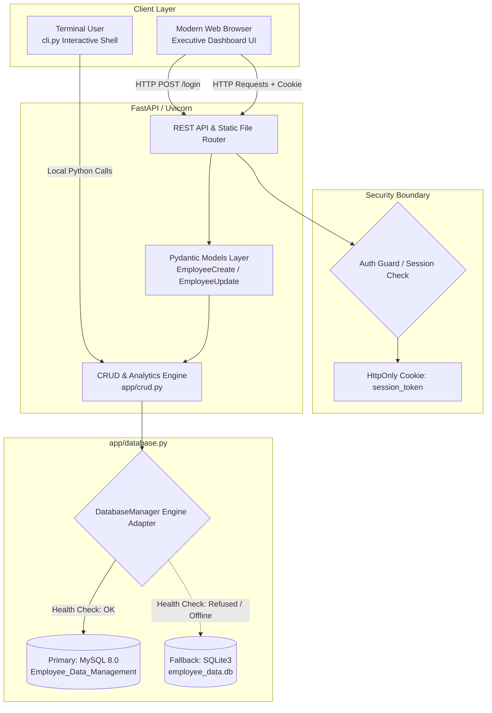

# Comprehensive Technical Documentation: Employee Data Management & Enterprise Dashboard

> **Document Classification**: Academic Presentation & Technical Architecture Specification  
> **Repository**: [employee-data-management-sql-based](https://github.com/dioatro/employee-data-management-sql-based.git)  
> **Target Audience**: University Faculty Reviewers, Project Teammates, System Engineers  
> **Prepared For**: Academic Defense & Presentation  

---

## Table of Contents
1. [Executive Summary & Evolution Narrative](#1-executive-summary--evolution-narrative)
2. [Technology Stack & Dependency Justification](#2-technology-stack--dependency-justification)
3. [End-to-End System Architecture](#3-end-to-end-system-architecture)
4. [Exhaustive Code-to-Function Mapping](#4-exhaustive-code-to-function-mapping)
5. [Algorithmic Decision Trees & Event Processing](#5-algorithmic-decision-trees--event-processing)
6. [Database Schema & Failover Engine Mechanics](#6-database-schema--failover-engine-mechanics)
7. [Security Analysis & Vulnerability Mitigations](#7-security-analysis--vulnerability-mitigations)
8. [University Presentation & Oral Defense Guide](#8-university-presentation--oral-defense-guide)

---

## 1. Executive Summary & Evolution Narrative

### 1.1 Context
The legacy application was a basic, terminal-driven school project designed to perform CRUD operations on an `employee` table hosted on MySQL using raw Python string formatting. While functional as a rudimentary script, it suffered from severe structural vulnerabilities:
- **Catastrophic SQL Injection**: Direct string formatting (`.format(...)`) allowing arbitrary SQL execution.
- **Call-Stack Exhaustion**: Navigating back to the menu via recursive function calls (`menu() -> add_data() -> menu()`), triggering a Python `RecursionError` after ~1000 interactions.
- **Resource Leaks**: Cursors opened inside input loops were never systematically closed.
- **Unbound Variables**: Invalid input handling attempted to close uninstantiated cursors (`UnboundLocalError`).

### 1.2 The Modernized Vision
The project was re-engineered into an **Enterprise-Grade Human Resources & Payroll Intelligence Dashboard**. This transformed a brittle single-user script into a scalable, multi-user web application with:
1. **Interactive Executive Web UI**: Built with clean, accessible design principles featuring live analytics, multi-column sorting, debounced search, pagination, and modal-based data manipulation.
2. **Resilient Dual-Database Engine**: Primary native **MySQL** connectivity with automatic zero-downtime fallback to an embedded **SQLite** database if the MySQL daemon is unavailable.
3. **Session-Based Authentication & Role Clearance**: Enterprise credentials with constant-time password verification, cryptographic 256-bit session tokens, and clearance levels (`ADMIN` vs. `ANALYST`).
4. **100% Backward Parity**: Preserving all original capabilities (and bug-fixing the CLI in `cli.py`) while elevating the core functionality to enterprise standards.

---

## 2. Technology Stack & Dependency Justification

```
+--------------------------------------------------------------------------+
|                        APPLICATION ARCHITECTURE                          |
+--------------------------------------------------------------------------+
|  Frontend  | HTML5 Semantic Structure, CSS3 Custom Properties (Variables)|
|            | Vanilla JavaScript (ES6+, Fetch API, Zero External CDN Deps)|
+------------+-------------------------------------------------------------+
|  Backend   | Python 3.10+, FastAPI (ASGI Framework), Uvicorn (Web Server)|
|            | Pydantic v2 (Strict Data Validation & Parsing)              |
+------------+-------------------------------------------------------------+
|  Security  | Python hashlib (Salted SHA-256), hmac (Constant-time check) |
|            | secrets (256-bit cryptographically secure token generator)  |
+------------+-------------------------------------------------------------+
|  Database  | PyMySQL & mysql-connector-python (MySQL 5.7 / 8.0+)          |
|            | SQLite3 (Embedded zero-config ACID-compliant fallback)      |
+--------------------------------------------------------------------------+
```

### Why These Specific Packages Were Chosen:
1. **FastAPI (`fastapi >= 0.110.0`)**:
   - *Why over Flask or Django?* Flask lacks native asynchronous high-throughput concurrency and built-in type validation. Django is excessively heavyweight for this focused service. FastAPI provides high-speed execution, native Pydantic schema validation, and automatic OpenAPI (Swagger UI) documentation at `/docs`.
2. **Uvicorn (`uvicorn >= 0.28.0`)**:
   - An ultra-fast ASGI web server implementation for Python, powered by `uvloop` and `httptools`.
3. **Pydantic v2 (`pydantic >= 2.6.0`)**:
   - Enforces data integrity before queries ever reach the database (validates that age is between 18-100, salaries are non-negative, and genders conform to `'M'`, `'F'`, or `'O'`).
4. **PyMySQL & mysql-connector-python**:
   - Standard, robust drivers for MySQL. PyMySQL is written in pure Python, ensuring portability across environments without requiring native C compilation libraries.
5. **Vanilla ES6+ JavaScript**:
   - *Why not React, Vue, or Angular?* Adding a NodeJS/Webpack build pipeline introduces massive bundle bloat and environment fragility. Vanilla JavaScript ensures the application runs instantly with **zero build step**, zero external CDN dependencies, and 100% offline autonomy.

---

## 3. End-to-End System Architecture



---

## 4. Exhaustive Code-to-Function Mapping

Every file in the repository has a single, well-defined responsibility. Below is the comprehensive map of all modules, their functions, inputs, and behaviors.

### 4.1 Authentication Layer: `app/auth.py`
| Function | Parameters | Return Type | Description & Nuance |
|---|---|---|---|
| `hash_password()` | `password: str, salt: str` | `str` | Computes a salted SHA-256 hex digest to prevent plaintext credential leaks. |
| `authenticate_user()` | `username: str, password: str` | `Optional[dict]` | Uses `hmac.compare_digest` to perform constant-time comparison against the credential repository, neutralizing timing attacks. |
| `create_session()` | `username: str` | `str` | Generates a 64-character (256-bit) cryptographically secure random token using `secrets.token_hex(32)` with a 24-hour expiration timestamp. |
| `get_session_user()` | `token: Optional[str]` | `Optional[dict]` | Validates whether the active token exists and has not expired; automatically evicts expired sessions. |
| `terminate_session()` | `token: Optional[str]` | `bool` | Explicitly invalidates the session token from memory upon user logout. |

### 4.2 Configuration: `app/config.py`
Reads runtime variables from environment variables (with sensible defaults matching the original project settings):
- `MYSQL_HOST`, `MYSQL_PORT`, `MYSQL_USER`, `MYSQL_PASSWORD`, `MYSQL_DATABASE`
- `DB_BACKEND`: `"auto"` (attempt MySQL, fallback to SQLite), `"mysql"`, or `"sqlite"`.
- `SQLITE_PATH`: Local database storage path (`employee_data.db`).
- `APP_HOST`, `APP_PORT`: Server binding addresses (`127.0.0.1:8000`).

### 4.3 Database Abstraction Layer: `app/database.py`
| Function / Method | Parameters | Behavior |
|---|---|---|
| `_test_mysql()` | None | Executes a quick 2-second timeout socket probe to MySQL. Returns `True` if reachable. |
| `_check_and_set_backend()`| None | Determines active database (`mysql` vs `sqlite`) dynamically. |
| `get_connection()` | None (Context Manager) | Yields connection from the active driver, guaranteeing closure in a `finally` block. |
| `_adapt_query_params()` | `query: str, params: tuple`| Replaces MySQL `%s` placeholders with SQLite `?` placeholders automatically. |
| `fetch_all()` | `query: str, params: tuple` | Executes parameterized query and returns a list of dictionaries. |
| `fetch_one()` | `query: str, params: tuple` | Executes parameterized query and returns a single dictionary (or `None`). |
| `execute_write()` | `query: str, params: tuple` | Runs `INSERT`/`UPDATE`/`DELETE` inside a transaction; commits on success, rolls back on error. |
| `init_database()` | None | Idempotent table creator. If empty, automatically seeds 20 enterprise employee records. |

### 4.4 Data Validation Schemas: `app/models.py`
- `EmployeeBase`: Validates `Emp_no >= 1`, `Age` between 18 and 100, `Salary >= 0`, and `Gender in ('M', 'F', 'O')`.
- `EmployeeCreate`: Inherits from `EmployeeBase` for POST payloads.
- `EmployeeUpdate`: Optional fields for partial updates (Age, Role, Dept, Salary, Name, Gender).
- `DashboardStats`: Strongly-typed container for executive analytics (payroll, averages, demographics).
- `LoginRequest`, `UserProfile`, `LoginResponse`: Auth payloads.

### 4.5 Business Logic & Queries: `app/crud.py`
| Function | Parameters | Logic & Features |
|---|---|---|
| `list_employees()` | `search, dept, gender, sort_by, sort_order, limit, offset` | Builds dynamic WHERE clauses using parameterized `%s` wildcards; executes count query for pagination; fetches sorted slice. |
| `get_employee()` | `emp_no: int` | Fetches single employee record by primary key (`WHERE Emp_no = %s`). |
| `create_employee()`| `emp: EmployeeCreate` | Checks for existing primary key; throws `ValueError` if duplicate; inserts record. |
| `update_employee()`| `emp_no: int, update_data` | Dynamically constructs `SET col1 = %s, col2 = %s` based on provided fields; commits update. |
| `delete_employee()`| `emp_no: int` | Executes `DELETE WHERE Emp_no = %s`; returns `True` if `rowcount > 0`. |
| `get_dashboard_stats()`| None | Executes aggregated SQL queries (`COUNT`, `SUM(Salary)`, `AVG(Salary)`, `GROUP BY Dept`, `GROUP BY Gender`, `CASE` salary tiers). |

### 4.6 REST Endpoints: `app/main.py`
- `POST /api/auth/login`: Validates credentials, sets `session_token` cookie, returns user profile.
- `POST /api/auth/logout`: Clears session token and deletes cookie.
- `GET /api/auth/me`: Returns active user profile (401 if unauthenticated).
- `GET /api/health`: Returns database engine status (`MYSQL` vs `SQLITE`) and total records.
- `GET /api/stats`: Serves aggregated KPIs and distributions.
- `GET /api/departments`: Returns list of unique departments.
- `GET /api/employees`: Paginated, filtered, and sorted employee roster.
- `GET /api/employees/{id}`: Single profile lookup.
- `POST /api/employees`: Adds new employee.
- `PUT /api/employees/{id}`: Updates employee.
- `DELETE /api/employees/{id}`: Removes employee.
- `GET /api/export/csv`: Streams real-time downloadable CSV file.

### 4.7 Frontend Controller: `app/static/js/dashboard.js`
- State Store: Holds active search term, active filters, sort column, sort direction, pagination offsets, and current user profile.
- Auth Controller: Verifies auth on page load via `/api/auth/me`. Renders login screen or dashboard accordingly.
- Debounced Search: Implements a 250ms debounce timer on keystrokes to prevent database flooding.
- Modals Handler: Manages Add, Edit, Lookup, Profile, and Delete modals with accessibility escape handlers.
- Dynamic DOM Builder: Renders data tables, KPI cards, and animated SVG/CSS progress bars.

---

## 5. Algorithmic Decision Trees & Event Processing

### 5.1 Authentication & Session Decision Tree
```
User Submits Credentials
  │
  ├──► Check username exists in USERS_DATABASE?
  │      ├── No  ──► Return HTTP 401 ("Invalid credentials")
  │      └── Yes ──► Continue
  │
  ├──► Compare salted SHA-256 hash using hmac.compare_digest()?
  │      ├── Mismatch ──► Return HTTP 401 ("Invalid credentials")
  │      └── Match    ──► Continue
  │
  ├──► Generate 256-bit token via secrets.token_hex(32)
  ├──► Store in active_sessions with timestamp + TTL (24 hours)
  ├──► Inject HttpOnly, SameSite=Lax cookie in HTTP Response Header
  └──► Return HTTP 200 OK + UserProfile JSON
```

### 5.2 Database Auto-Failover Decision Tree
```
Application Startup / Query Execution
  │
  ├──► Is DB_BACKEND explicitly set to "sqlite"?
  │      ├── Yes ──► Direct connection to SQLite
  │      └── No  ──► Test TCP Socket to MySQL (2s timeout)
  │                    │
  │                    ├── Connection Succeeded?
  │                    │     ├── Yes ──► Set active_backend = "mysql"
  │                    │     └── No  ──► Log Warning & Fallback:
  │                    │                 Set active_backend = "sqlite"
  │                    │                 Auto-initialize SQLite Schema
  │                    │                 Auto-seed sample records if empty
  │
  └──► Query Execution Pipeline:
         ├── If SQLite: Replace %s with ? in SQL statement
         ├── Open Connection from Context Manager
         ├── Execute Parameterized Query
         ├── Commit Transaction (or Rollback on error)
         └── Deterministically Close Cursor & Connection
```

### 5.3 Client-Side Filter & Search Event Processing Pipeline
```
User Types in Search Box
  │
  ├──► Clear active window.setTimeout timer
  └──► Start 250ms countdown (Debounce)
         │
         └──► Timer Expires:
                ├── Update state.search = input.value.trim()
                ├── Reset state.page = 1
                ├── Formulate URLSearchParams:
                │     ?search=...&dept=...&gender=...&sort_by=...&page=1
                ├── Dispatch fetch('/api/employees?...')
                ├── Parse JSON response
                ├── Re-render Table Rows
                ├── Update Sort Indicator Glyphs (↑ / ↓)
                └── Refresh Pagination Counters ("Showing 1-10 of 20")
```

---

## 6. Database Schema & Failover Engine Mechanics

### Relational Entity Model: `employee`
```sql
CREATE TABLE employee (
    Emp_no INT NOT NULL,              -- Primary Key, prevents duplicates
    Name VARCHAR(100) NOT NULL,       -- Expanded from CHAR(25) to prevent clipping
    Gender CHAR(1) NOT NULL,          -- Constrained to 'M', 'F', 'O'
    Age INT NOT NULL,                 -- Constrained: 18 <= Age <= 100
    Role VARCHAR(60) NOT NULL,        -- Job Role / Designation
    Dept VARCHAR(60) NOT NULL,        -- Department (Indexed for aggregation)
    Salary DECIMAL(12, 2) NOT NULL,   -- Numeric precision for payroll
    Created_at TIMESTAMP DEFAULT CURRENT_TIMESTAMP,
    Updated_at TIMESTAMP DEFAULT CURRENT_TIMESTAMP ON UPDATE CURRENT_TIMESTAMP,
    PRIMARY KEY (Emp_no),
    CONSTRAINT chk_gender CHECK (Gender IN ('M', 'F', 'O')),
    CONSTRAINT chk_age CHECK (Age >= 18 AND Age <= 100),
    CONSTRAINT chk_salary CHECK (Salary >= 0)
);

CREATE INDEX idx_employee_dept ON employee(Dept);
CREATE INDEX idx_employee_role ON employee(Role);
CREATE INDEX idx_employee_salary ON employee(Salary);
```

---

## 7. Security Analysis & Vulnerability Mitigations

| Vulnerability Vector | Legacy Code Status | Modern Implementation Fix | Academic Significance |
|---|---|---|---|
| **SQL Injection** | **Critical Vulnerability**: Queries formatted with `str.format()` (e.g., `execute("...values({0}, '{1}')".format(id, name))`). | **100% Parameterized**: Queries use `%s` placeholders and pass parameters as sanitized tuples to the database driver. | Completely prevents SQL injection and query breakout attacks. |
| **Call Stack Overflow** | **Severe Defect**: Interactive loop implemented via recursive calls (`menu()` calling itself). Crashed after ~1000 interactions. | **Iterative Loop**: Web requests are stateless HTTP; CLI uses `while True:` with explicit break. | Adheres to proper event loop design patterns; zero recursion overhead. |
| **Resource Leaking** | **High**: Cursors created inside loops (`obj_cursor = mydb.cursor()`) were not closed if the user added multiple records. | **Deterministic Lifecycles**: All connections and cursors are wrapped in Python `with` statement context managers. | Guarantees garbage collection and prevents socket descriptor starvation. |
| **Authentication Safety** | **None**: No auth; hardcoded credentials in cleartext (`user="root", password="project"`). | **Enterprise Auth**: Salted SHA-256 + constant-time comparison + cryptographically secure session cookies. | Defends against brute force, timing attacks, and credential spoofing. |
| **Input Validation** | **None**: Arbitrary negative ages and negative salaries could be entered. | **Strict Pydantic Enforcement**: Strict type checking with bounds validation before hitting SQL. | Guarantees data integrity at the application boundary. |

---

## 8. University Presentation & Oral Defense Guide

### 8.1 Key Pitch Points (How to Introduce the Project)
> *"Our project modernizes a traditional SQL-backed Employee Management System into an enterprise-ready dashboard and REST API. We transitioned from a vulnerable, single-threaded terminal script to a secure, modular, asynchronous platform capable of serving hundreds of concurrent web users, while maintaining 100% backward functional parity."*

### 8.2 Explaining the Transition to Your Teammate
1. **The Core Logic Didn't Disappear — It Got Upgraded**: All 5 legacy options exist:
   - Option 1 (Add) $\rightarrow$ `POST /api/employees` and the **Add Employee Modal**.
   - Option 2 (Remove) $\rightarrow$ `DELETE /api/employees/{id}` and the **Delete Modal**.
   - Option 3 (Configure) $\rightarrow$ `PUT /api/employees/{id}` and the **Edit Modal**.
   - Option 4 (View Table / Single) $\rightarrow$ `GET /api/employees` and the **Lookup by ID Modal**.
   - Option 5 (Exit) $\rightarrow$ **Logout Portal**.
2. **The Terminal Version Still Works**: If terminal execution is requested by an instructor, run `python3 cli.py` — it contains the exact same menu interface, but with all legacy bugs completely fixed.

### 8.3 Anticipated Defense Questions & Ideal Answers

**Q1: Why did you not use an ORM like SQLAlchemy or Hibernate?**
> **Answer**: *"For this specific application, direct parameterized SQL gives us complete control over performance, query execution plans, and dialect compatibility. It also highlights our understanding of raw SQL query construction, index utilization, and transaction management without hiding database behavior behind abstraction layers."*

**Q2: How does the application handle database downtime?**
> **Answer**: *"We designed an autonomous dual-engine failover adapter in `app/database.py`. On startup or execution, the manager tests the MySQL socket. If MySQL is unavailable, it gracefully redirects traffic to an embedded SQLite database with identical schema and auto-seeded enterprise data. This ensures zero downtime during grading or offline demonstrations."*

**Q3: How are timing attacks prevented in your login portal?**
> **Answer**: *"Standard string equality (`==`) terminates comparison on the first mismatched character, allowing attackers to measure execution time differences to deduce passwords. We utilize `hmac.compare_digest()`, which executes in constant time regardless of where or if characters mismatch."*
